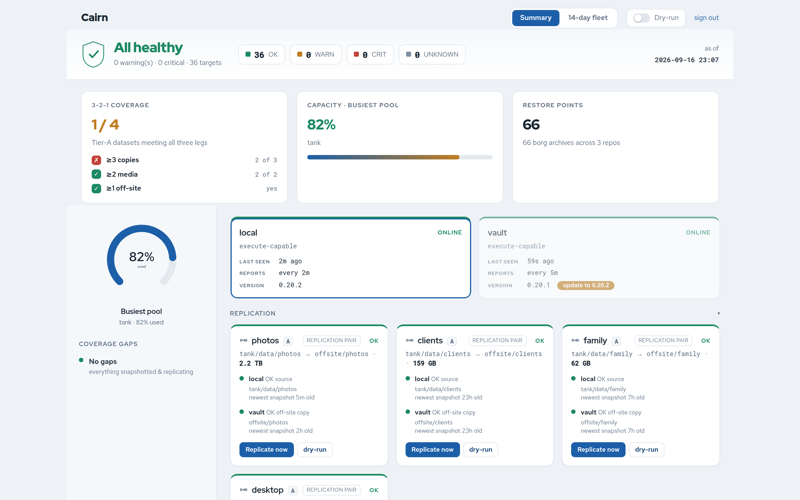
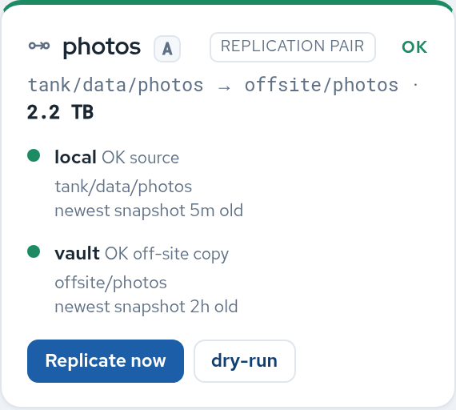
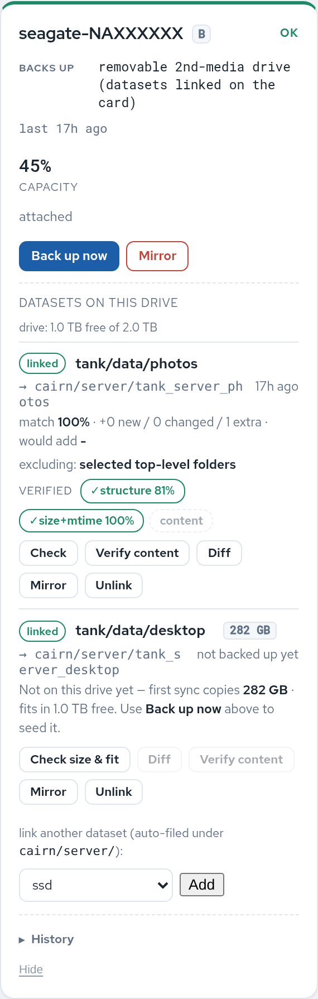
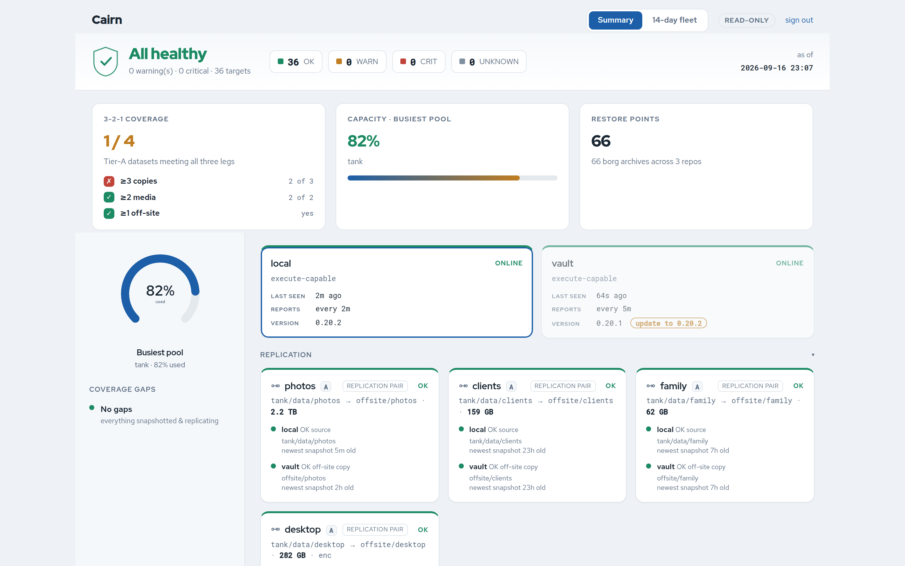

# Cairn

[](https://github.com/jmichelsen/cairn/commits/main)

*A cairn marks the safe path and endures the weather - so you always know your way back to your data.*

One dashboard for the health of every backup on a ZFS host, with email + Gotify alerts and
**push-button actions**. Self-hosted: one small API container + SQLite, plus a small agent on each
host. No phone-home, no cloud.

What it watches:

- **ZFS**: pool health, capacity and scrub age, snapshot freshness (derived from `sanoid.conf`),
  **replication lag** (newest snapshot common to source and destination), resilvers and vdev
  errors, and zed's event timeline.
- **Other backup tools**: borg and restic repos, rclone remotes, snapper (btrfs), backupninja
  handlers, systemd backup timers (syncoid/sanoid).
- **Hardware and host**: SMART, kernel disk/link errors, AIDE file-integrity changes, SSH
  reachability of a remote site.
- **Removable drives**: an external "2nd leg" drive, with dataset matching, size/fit census,
  content verify and a one-click incremental **Back up now**.

Why it's different from a generic uptime monitor: it understands *backups*. It pairs a dataset
with its off-site copy into one end-to-end card, grades a **3-2-1 scorecard**, shows a
**coverage-gap** view ("what is backed up by nothing"), respects zero-knowledge encrypted replicas
(CRIT if a destination's key unexpectedly loads), and has a **recovery browser** (snapshots,
deleted files, file versions, copy-only restore).

It also **watches its own alerting.** A placeholder SMTP host or a stale push token delivers
*nothing* while the dashboard still looks fine, so cairn self-tests its delivery path and reports
the verdict to an independent [uptime-kuma](https://github.com/louislam/uptime-kuma) monitor. If
cairn can't reach you, Kuma can. See [Notify self-test heartbeat](#notify-self-test-heartbeat).

## Screenshots

[](docs/img/dashboard-full.png)

The summary view: 3-2-1 scorecard, busiest-pool capacity, agent tiles (with self-update prompts),
and replication **pair cards** that merge a source and its off-site copy into one end-to-end signal.
*(Anonymized - generic host/dataset names stand in for a real deployment.
[Full-page capture](docs/img/dashboard-full.png).)*

| Replication pair | Removable 2nd-leg | Read-only viewer |
| --- | --- | --- |
| [](docs/img/pair-card.png) | [](docs/img/removable-card.png) | [](docs/img/viewer-readonly.png) |

## Documentation map

| Doc | What's in it |
| --- | --- |
| [docs/getting-started.md](docs/getting-started.md) | **New to ZFS / sanoid / cairn? Start here:** the pieces, then a step-by-step setup with checks |
| This README | Install, concepts, the dashboard, accounts, alerts, updating |
| [docs/targets.md](docs/targets.md) | **Every target type and key** you can put in `targets.yaml` |
| [AGENT.md](AGENT.md) | The agent: tokens, settings, actions, dry-run, recovery, troubleshooting |
| [docs/architecture.md](docs/architecture.md) | How the pieces fit: control plane, intents, auth, pairing, the off-site pull |
| [replication/README.md](replication/README.md) | The vault's nightly pull and how its SSH key is locked down |
| [config/cairn.env.example](config/cairn.env.example) | Every API / alerting setting |

## Quick start (`./install.sh`)

One entry point. It **installs missing prerequisites** (docker or podman, compose, python3-yaml,
...), asks a few questions, elevates with one sudo for the system parts (prerequisites,
borg/backupninja read access and linger; later steps you say yes to, like ZFS permissions or sanoid
entries, may ask again), then builds, configures and starts the API container and the
execute-capable host agent. Re-running is idempotent (tokens and config are kept). Run it as
your normal user, not root: the agent is a systemd user service.

```bash
# one-liner - self-clones to ~/cairn, then installs:
curl -fsSL https://raw.githubusercontent.com/jmichelsen/cairn/main/install.sh | bash
```
or clone first:
```bash
git clone https://github.com/jmichelsen/cairn && cd cairn
./install.sh            # answer: role=home, alert email, (optional) Gotify, (optional) add a vault
```

Open `http://<host>:8929/` and sign in with the `CAIRN_ADMIN_TOKEN` it prints (under "Sign in with
a token"), then create a password account (see [Accounts and sharing](#accounts-and-sharing)).
Prompts read from your terminal even under `curl ... | bash`. The bootstrap clones to `~/cairn`
(override with `CAIRN_DIR=` / `CAIRN_REPO=`).

| Command | What it does |
| --- | --- |
| `./install.sh` | Interactive: asks for the role (`home` or `vault`) |
| `./install.sh home` | This box = API + dashboard + local agent |
| `./install.sh vault --config vault-install.conf` | This box = a remote agent, from the bundle home wrote |
| `./install.sh home --add-vault` | Add a remote vault to an existing home (a vault on another SSH port: `user@host:2222` at the prompt, or `--vault-port`) |
| `./install.sh home --replication [--vault-ssh user@host[:port]] [--home-port N]` | Set up (or re-sync) the vault's nightly pull, see [replication/README.md](replication/README.md). Non-standard SSH ports work both ways |
| `./install.sh --update` | Refresh the code (git pull, or a tarball that keeps `config/`) and restart the agent. The dashboard's **Update** button runs this |
| `./install.sh --smart-detail` | Also install the scoped `smartctl` wrapper for SMART attribute tables |
| `./install.sh --check` | Preflight only, changes nothing |
| `phase1/zfs-perms.py [--apply]` | Show (and grant) the ZFS permissions this host's targets need, see [ZFS permissions](#zfs-permissions) |
| `phase1/sanoid-setup.py [--print] [--yes] [--dataset DS] [--vault [user@host[:port]]] [--vault-only]` | Wizard: asks what snapshot schedule each dataset cairn watches should get (sanoid's example policies) and writes the sanoid.conf entries. `--vault` does the vault too, over ssh (bare: `CAIRN_VAULT_SSH`). See [docs/getting-started.md](docs/getting-started.md#4-snapshot-on-a-schedule-sanoid) |
| `./install.sh --rename-agent NEW` | Rename this box's agent without losing its history (stops it, renames it in the API, switches the setting, restarts it; offers to update the vault), see [AGENT.md](AGENT.md#renaming-an-agent) |
| `phase1/doctor.py [--problems] [--vault user@host[:port]]` | Check this host's whole setup (and the vault's) and list every problem with its fix, see [Checking a setup](#checking-a-setup-doctor) |
| `./install.sh home --configure` | Re-run configuration. **Destructive:** regenerates every token, so every agent must be re-enrolled |
| `--yes` / `-y` | Accept defaults, no prompts. Adds no optional tools; on home it still writes the default sanoid policy (production) for watched datasets sanoid.conf doesn't cover, and takes their first snapshots |

**Podman works too.** If the host has Podman (native `podman`, or its `docker` emulation from
`podman-docker`), the installer uses it: it enables `podman.socket` (needed by compose) and
`podman-restart.service` (restarts the container after a reboot) as rootless user units, with
linger. Compose comes from `podman compose` with docker-compose or podman-compose as its provider.

**Remote off-site vault.** When `install.sh` (on home) asks *"add a remote vault?"*, it mints a
per-vault enrollment secret and either writes a `vault-install.conf` bundle to copy over, **or**,
if the vault is reachable by SSH, offers `ssh-copy-id` and then pushes and runs the vault install
for you (non-interactively: sanoid is installed there, and the vault agent can run its dashboard
actions). It then offers to set up the nightly replication pull.

<details><summary>Manual Docker setup (what install.sh automates)</summary>

```bash
cp config/cairn.env.example config/cairn.env   # 3 tokens (openssl rand -hex 32) + SMTP/Gotify
cp config/targets.example.yaml config/targets.yaml               # list YOUR pools / datasets / repos
docker compose --profile container-agent up -d --build         # api + report-only container agent
```
A plain **`docker compose up -d --build`** starts the **api only**. That's the mode for the
execute-capable host agent (`phase1/grant-access.sh` + the host agent unit, see `AGENT.md`), and
it's what `install.sh home` sets up. The container agent is opt-in (the `container-agent` profile)
so it can't start alongside the host agent by accident: both report this host's targets, so running
both either overwrites each other's cards (same name) or shows every dataset twice (different names). Same commands with `podman-compose` (1.0.6+ for profiles).
</details>

### Report-only container mode

The `container-agent` profile runs an **unprivileged, report-only** agent in a container, handy
for kicking the tires. Its image carries only the ZFS, borg, smartmontools and mail tools, so:

| Works in the container | Needs the host agent |
| --- | --- |
| ZFS pool health, capacity, scrub age, snapshot freshness, **replication lag**, resilver / vdev errors | **All action buttons** (snapshot, replicate, scrub, restore, recovery browser, removable backups) |
| borg repos and backupninja handlers (mount them read-only into the container) | restic, rclone, snapper (their tools aren't in the image) |
| kernel disk errors (from a mounted `/var/log/kern.log`) | zed event timeline, systemd timers, smartd alerts (need the host's journal / systemd) |
| 3-2-1 scorecard, coverage gaps, timeline | AIDE, pre/post hooks |

Targets owned by a report-only agent show **"report-only"** instead of action buttons, and the
API refuses to queue actions for them, so nothing hangs. Switching to the host agent is covered in
[AGENT.md](AGENT.md#upgrading-past-read-only-container-to-host-agent).

## What runs where

| Piece | Component | Privilege |
| --- | --- | --- |
| API + dashboard, SQLite, alert dispatch (**no host access**) | **api** (container) | unprivileged; holds the SMTP/Gotify creds |
| Status reads (ZFS, borg, SMART, logs, ...) and reporting | **agent** on the host (systemd user service) | your normal user + read grants from `grant-access.sh` |
| On-demand **actions** (snapshot, syncoid, scrub, rsync, restore) | the same agent with `CAIRN_CAN_EXECUTE=1` | `zfs allow` delegation; scrub via an opt-in sudo wrapper |
| Off-site **vault** reporting + pulls | **same agent**, remote | outbound HTTPS + token; no inbound, no alert creds |

**One uniform agent** does all host work, locally and remotely, talking only HTTP to the API. The
API never touches ZFS. Commands are built from the agent's trusted local `targets.yaml`, never
from the wire. See [docs/architecture.md](docs/architecture.md) for the intent queue, detached
jobs, auth and pairing (with diagrams).

## ZFS permissions

The agent runs as your normal user, so ZFS has to be told what that user may do (`zfs allow`
delegation). You don't need to work this out by hand: `phase1/zfs-perms.py` reads this host's
`targets.yaml`, lists every dataset that needs a grant, why, and what you already hold. The
installer runs it on home and vault and offers to grant what's missing; run it again any time you
change `targets.yaml`:

```bash
phase1/zfs-perms.py               # show the plan
phase1/zfs-perms.py --apply       # grant the missing required ones (one sudo per dataset), then verify
phase1/zfs-perms.py --apply --all # also the optional Snapshot-button grants
```

| On this host | Required | Also granted (recommended) | On |
| --- | --- | --- | --- |
| Source of a local Replicate | `snapshot,send` | `hold` | the source dataset |
| Source a vault pulls (`dest_agent:`) | `send` | `snapshot,hold` | the source dataset |
| Destination of a local Replicate, or a vault's replica (`source_agent:`) | `create,mount,receive` | `mountpoint` | the destination's pool |
| Snapshot button on a `zfs-local` dataset | (optional) `snapshot` | | that dataset |

**The agent checks this every cycle.** A replication card whose agent user lacks a *required*
grant turns WARN with the reason, e.g. "ZFS permission missing: 'alice' lacks send on
tank/photos ... Fix: run phase1/zfs-perms.py --apply on this host". Missing recommended or optional
grants never warn.

It never grants `destroy`, `rollback` or anything else that can delete data, and never grants
Snapshot on a vault replica (a local snapshot there breaks the next pull). Run it as the agent's
user, not from a root shell. Linux only lets root mount filesystems, so a dataset a non-root user
receives may stay unmounted; the data and snapshots are still there.

## Checking a setup (doctor)

New to all of this? Follow [docs/getting-started.md](docs/getting-started.md) first. Something not
working, or a new box just installed? Run the doctor on **every** box that runs an
agent (main box and vault), as the agent's user, from the cairn checkout:

```bash
phase1/doctor.py               # everything
phase1/doctor.py --offline     # skip the API and ssh checks
phase1/doctor.py --no-collect  # skip the dry collection (the slowest part)
phase1/doctor.py --problems    # only what needs fixing: WARN/FAIL lines and their fixes (or --warnings, -p)
phase1/doctor.py --vault user@vault:2222   # main box: also check the vault over ssh
```

**Checking the vault from the main box.** With `--vault user@host[:port]` (repeatable), or
`CAIRN_VAULT_SSH` in `cairn.env` (comma-separated; `./install.sh home --replication` records it), the
doctor logs in to the vault with your normal ssh key (`BatchMode`, so it never hangs on a password
prompt; a non-standard port goes after the colon), reads its `targets.yaml`, `replication.conf`,
agent name and pools, and compares them with this box's `zfs-repl` targets: the dest pool exists
there, `dest_agent` is the vault's real agent name, a vault `zfs-local` watches each dest under the
same name with `source_agent`, a SET pulls it from the right source (raw when `encrypted`), and the
vault pulls nothing this box doesn't declare. It then runs the vault's own doctor there (0.38 or
newer), which includes the vault's ssh test back to this box on the `PORT` in its `replication.conf`.
This works without the API, so it still helps when a pair never showed up on the dashboard.

It reads the settings the agent really uses (the unit's `Environment=` lines win over `cairn.env`)
and prints each check as `ok`, `info`, `WARN` or `FAIL`, every problem with a `fix:` line:

| Section | What it checks |
| --- | --- |
| agent | The unit is installed, running and enabled; lingering is on (else the agent stops at logout); not crash-looping; **only one agent process** runs (a container agent next to the systemd one is the classic duplicate); the agent started after the last code update and the last `targets.yaml` edit (else: restart it) |
| settings | API url and where it came from, a credential is set, agent name, dry-run left on, report-only mode, `cairn.env` not readable by others, `cairn.env` values the unit overrides |
| api | The API answers, its version matches this checkout (which side to update if not), this agent's credential is accepted, plus the **fleet findings about this agent** (below) |
| targets | `targets.yaml` parses; every target has a unique name and a known type; required keys present; unknown keys flagged with a suggestion (`dest-agent` → `dest_agent`); `dest` is a dataset, not a path or `user@host`; complete `scrub_cadence` entries |
| zfs | Sources exist; a `zfs-repl` dest on another box has `dest_agent` (and a local one doesn't); a vault-pulled source has snapshots to pull; every required ZFS delegation is held (same rules as `zfs-perms.py`); httm installed or opted out; stuck httm processes |
| sanoid | Every replicated source is snapshotted on a schedule (else the copy stops moving); a received copy is never snapshotted by sanoid (that breaks the next pull); copies nothing prunes are noted; `sanoid.timer` enabled. Points at `phase1/sanoid-setup.py` |
| tools | The programs each configured target type needs (`borg`, `restic`, `smartctl`, `rsync`, `syncoid`...) |
| pull | Vault only: `replication.conf` complete, pull key present and private, `syncoid` installed, **each SET named like the target that watches its dest** (the "Replicate now" join), receivers have `source_agent`, no existing empty dest blocking the first pull, ssh to home with the pull key (on its port), the timer is enabled, the last pull's result |
| status | A dry collection: what the agent would report right now, every non-OK target with its reason |

Exit code 0 means nothing FAILed. The output holds no secrets, so paste all of it when asking for help.

**Fleet check.** Some problems only show when you look at two agents together, so the API checks
those across all agents and lists them in a "configuration problems" banner at the top of the
dashboard (and at `GET /api/v1/backup/doctor`): a `dest_agent` that names no known agent, a
home → vault replication whose dest no vault target watches (with the near-miss dataset if there is
one), a pair whose two names differ (the vault's Replicate now pulls by name), a receiver missing
`source_agent` or naming the wrong one, a receiver nothing sends to, two replications writing into one
dataset, missing ZFS delegations, agents silent or on another version, and **two agents reporting
under one name** (they overwrite each other's cards). The doctor on a host shows the ones about that
host.

## Replication targets (`zfs-repl`)

A `zfs-repl` target **watches** a replication you already run; it does not schedule one. Each check
compares the newest snapshot on `source` with the newest on `dest` and alerts when the copy falls
behind (`repl_warn_h` / `repl_crit_h`). The card's **Replicate** button runs a one-off
`syncoid --no-privilege-elevation --no-stream <source> <dest>` on demand (raw `--sendoptions=w`
when `encrypted: true`); the regular schedule is yours, e.g. a syncoid timer, or the vault's
nightly pull below.

`source` and `dest` are **dataset names** exactly as `zfs list` prints them (`pool/dataset`),
never mountpoints. Pick the form by where the copy lives:

**1. On the same machine** (a second pool, a USB pool):

```yaml
- { name: photos, type: zfs-repl, source: tank/photos, dest: backup/photos, tier: A }
```

The agent reads both sides and reports the real lag. Until the first replication has run, the card
shows UNKNOWN "dest has no snapshots".

**2. On another machine (a vault):** that machine runs its own cairn agent (`./install.sh vault`).
The nightly pull is set up **from home**: `./install.sh home --replication` (also offered when you
add a vault) turns each home `zfs-repl` target into a pull set and installs the vault's nightly
`cairn-pull` timer; see [replication/README.md](replication/README.md). An agent only sees its own
pools, so the pair is declared on both sides, **using the same `name`**. `--replication` adds the
vault's half for you when it's missing:

```yaml
# home targets.yaml: the sending half (dest = the dataset name ON THE VAULT)
- { name: photos_offsite, type: zfs-repl, source: tank/photos, dest: vault/photos, tier: A,
    dest_agent: vault }
# vault targets.yaml: the receiving half (source_agent = the home agent's CAIRN_AGENT_NAME: its
# short hostname on a fresh install, "local" on installs from before 0.41)
- { name: photos_offsite, type: zfs-local, source: vault/photos, source_agent: homebox }
```

The halves merge into one pair card because home's `dest` is exactly the vault target's `source`.
The shared `name` matters for the button: the installer names each pull set after the home target,
and the vault card's **Replicate now** pulls the set whose name matches its own.

With `dest_agent` set, home reports its own source-snapshot freshness ("paired -> vault") instead
of an UNKNOWN for a dest it can't see. The vault reports how fresh the off-site copy really is. The
pair card shows the worse of the two halves (or the vault's alone if home can't tell). A remote
`user@host:pool/dataset` dest is not supported: the agent can't see snapshots on a host it doesn't
run on.

Encrypted copies: `encrypted: true` makes Replicate send raw, and raises CRIT if the destination's
key is ever loaded (a zero-knowledge copy should never be readable there). The expected state is
`unavailable`; override it with `vault_keystatus_expected:` if your design differs.

## Tier A and the 3-2-1 scorecard

`tier` is a label you set on a target in `targets.yaml`; cairn never assigns it. Only one value
does anything: **`tier: A` on a `zfs-repl` target puts that dataset in the 3-2-1 scorecard.**
Any other value (B, C, ...) is just a badge on the card.

Mark the replication targets for data you can't re-download or recreate (photos, documents, VM
images you care about) as tier A, and leave replaceable data (media libraries, caches, scratch)
untagged so it doesn't count against your score.

```yaml
- { name: photos,        type: zfs-repl, source: tank/photos, dest: backup/photos, tier: A }
- { name: photos_vault,  type: zfs-repl, source: tank/photos, dest: vault/photos,  tier: A,
    dest_agent: vault }
```

For each tier A **source dataset** (all of its replication targets are grouped together) the
scorecard counts:

- **copies** and **media**: the distinct pools holding it (source + every destination), plus one
  of each for a confirmed removable-drive copy that has synced or been content-verified within
  `CAIRN_REMOVABLE_STALE_D` days (default 90).
- **off-site**: a destination marked `location: offsite`, or a destination another agent holds
  (a vault whose `zfs-local` source is exactly this target's `dest`, i.e. a merged pair).

A dataset passes with **3+ copies, 2+ media and 1+ off-site**; the overall badge passes only when
every tier A dataset does (and fails if there are none). Each failing card says what's missing (no
off-site copy, a stale removable drive, or a missing 3rd copy).

## Using the dashboard

- **Cards** are grouped per agent (the agent tiles double as tabs). Click a severity count in the
  header to filter the whole fleet to it. Cards refresh every 20 seconds.
- **Actions** (per card, execute-capable agents only): Snapshot, Replicate (or no-snap: send
  existing snapshots only), Replicate now (vault pull), Scrub (pool roots, when the scrub wrapper is
  installed), Back up now (removable), AIDE Accept. Every click shows the exact command first; the
  **Dry-run** box in the top bar turns clicks into dry-runs. Results and live progress land in the
  **Activity** pane.
- **Acknowledge** a WARN/CRIT to take it out of the header count until its reason changes or
  `CAIRN_ACK_TTL` (14 days) passes. It does not stop the alert emails; those repeat per the
  cooldowns in [Alerts](#alerts).
- **Hide** a card you don't want (it stays hidden even while the agent reports it; unhide it
  from the Hidden pane). A target you remove from an agent's `targets.yaml` disappears on its own
  at the agent's next report. If two agents report the same dataset under the same name, a
  **reconcile** banner offers to retire one or keep both.
- **Recovery browser** (dataset cards): **Snapshots** lists snapshots instantly; **Deleted** and
  **Versions** browse files that are gone or changed, from a nightly scan plus on-demand folder
  scans (needs `httm`, optional); **Restore** copies a version into the dataset's
  `.cairn-restores/` folder and never touches live files. Details in
  [AGENT.md](AGENT.md#recovery-httm).
- **Removable drives**: plug the drive in, press **Detect matching datasets** and confirm the
  suggestions (or add a link by hand). Each link gets a size/fit census, a diff, a content verify,
  optional mirror mode (deletes on the drive what's gone from the source) and per-link excludes.
  **Back up now** runs a detached incremental rsync into `cairn/<host>/<dataset>/` on the drive
  that survives agent restarts. Keys are in [docs/targets.md](docs/targets.md#removable).
- **Coverage gaps** lists what's backed up by nothing, not snapshotted, or has no off-site copy;
  **busiest pool** and the **14-day fleet** heatmap sit in the summary.

## Accounts and sharing

Sign in with a **password account** or a **token**. Accounts are managed with `cairn-user.py`
inside the API container (run from `~/cairn`; `podman compose` works the same):

```bash
docker compose exec api python3 /app/phase1/cairn-user.py add alice --role admin    # prompts for a password
docker compose exec api python3 /app/phase1/cairn-user.py add demo  --role viewer   # read-only
docker compose exec api python3 /app/phase1/cairn-user.py passwd alice
docker compose exec api python3 /app/phase1/cairn-user.py list
```

`role`, `disable`, `enable` and `remove` work the same way. Changing a password or role signs that
user out everywhere. Sessions last `CAIRN_SESSION_TTL` (7 days). The audit trail records which
account clicked each action.

**Read-only share link:** mint a viewer token and send `https://<your-cairn>/login?token=<token>`.
It signs the browser in read-only for 30 days and works for anyone you send it to, as often as they
open it, until you revoke it:

```bash
docker compose exec api python3 /app/phase1/cairn-token.py mint --role viewer --label demo
docker compose exec api python3 /app/phase1/cairn-token.py list
docker compose exec api python3 /app/phase1/cairn-token.py revoke --label demo
```

Agent, admin and phone tokens use the same tool (and the same `/api/v1/backup/tokens` API), see
[AGENT.md](AGENT.md#auth-zero-trust).

## Alerts

The API sends every alert; agents hold no mail or push credentials. Settings live in
`config/cairn.env` ([example](config/cairn.env.example)).

- **Email** via SMTP (`MAIL_MODE=smtp`, `relay` is an alias) or local `sendmail`, to
  `NOTIFY_EMAIL`. A local relay such as an `msmtpd` sidecar keeps credentials off the host; with a
  plain relay, `NOTIFY_EMAIL` must be a real address (the relay ignores `/etc/aliases`).
- **Per-severity routing:** `EMAIL_CRIT`, `EMAIL_WARN`, `EMAIL_INFO` = `immediate`, `digest` or
  `off` (defaults: CRIT and WARN immediate, INFO off). Digest items go out once a day at
  `CAIRN_DIGEST_HOUR` (default 8, `off` disables).
- **Gotify** push for CRIT (add WARN with `NOTIFY_GOTIFY_WARN=1`).
- **Cooldowns:** the same finding re-alerts at most every `COOLDOWN_CRIT` (6 h) / `COOLDOWN_WARN`
  (24 h) while it lasts.
- **Silent agents:** an agent that stops reporting raises WARN after 3 missed intervals (at least
  10 minutes) and CRIT after 8 (at least 20 minutes). Tune with `CAIRN_AGENT_STALE_FACTOR`,
  `CAIRN_AGENT_MISS_FACTOR` and `CAIRN_AGENT_STALE_FLOOR`.
- **Action results:** a failed action alerts as CRIT; a finished one is an INFO notice.

## Updating

- **Agents:** press **Update** on an outdated agent's tile (the dashboard flags agents older than
  the API), or run `./install.sh --update` on that host. It pulls the code (keeping `config/`) and
  restarts the agent.
- **The API container:** re-running `install.sh` leaves a running API alone, so rebuild it
  yourself after pulling: `cd ~/cairn && git pull && docker compose up -d --build api`.
- **Read-only accounts** see "X available (admin only)" as plain text instead of the Update button;
  sign in as an admin to update.

## Pre/post hooks (e.g. consistent VM snapshots)

A target in `config/targets.yaml` can wrap cairn's **snapshot**, **sync** and **backup-now**
actions in its own commands, e.g. freeze a VM's filesystems so its snapshot is consistent, then
release it before the snapshot is copied elsewhere:

```yaml
- { name: vms, type: zfs-local, source: tank/vms,
    pre_cmd: "virsh domfsfreeze web", post_cmd: "virsh domfsthaw web" }
```

| Key | Default | Meaning |
| --- | --- | --- |
| `pre_cmd` | none | Runs (`sh -c`) before the action. Non-zero exit **skips** the action. |
| `post_cmd` | none | Always runs after the action once `pre_cmd` has run, even if the action failed or was skipped. Non-zero exit fails the action. |
| `hook_actions` | all three | Limit which actions are wrapped, e.g. `[snapshot]`. Other actions (scrub, restore, ...) are never hooked. |
| `hook_timeout_s` | `600` | Each hook is killed after this many seconds (counts as a failure). |

Hooks see `CAIRN_ACTION`, `CAIRN_TARGET` and `CAIRN_SOURCE`; `post_cmd` also gets
`CAIRN_RESULT=ok|fail|skipped`. They run as the agent's user, come only from the local
`targets.yaml` (never from the dashboard or the API), and a dry-run lists them without running them.

**Scheduled snapshots don't go through cairn.** For sanoid's own snapshots use its
`pre_snapshot_script` / `post_snapshot_script` (with `no_inconsistent_snapshot = yes`), and run
syncoid with `--no-sync-snap` so it only sends those quiesced snapshots instead of taking its own.

## File integrity (AIDE)

An `aide` target shows file-integrity changes that nobody has reviewed yet, one row per changed
path, each with an **Accept** button (plus **Accept all**). Read-only viewers see the list without
the buttons. cairn stores which account clicked with each accept (the intent's `requested_by`).

```yaml
- { name: aide, type: aide }        # optional: check_cmd (default /usr/local/sbin/aide-check.sh), severity (WARN), label
```

cairn doesn't run AIDE itself. It expects a root-owned checker script that keeps a pending list
and supports two commands: `--list` (print `first_seen<TAB>kind<TAB>path` lines) and
`--accept [PATH...]` (acknowledge all, or just those paths). Because AIDE's state is root-only, the
agent's user needs a NOPASSWD sudoers rule for exactly that script (sudo-rs friendly, no argument
wildcards):

```
youruser ALL=(root) NOPASSWD: /usr/local/sbin/aide-check.sh
```

A sensible checker absorbs changes that package updates explain (so routine upgrades never reach
the list) and re-sends unexplained ones daily until accepted. Its alert mail can link straight to
the card: `https://<your-cairn>/#cc-<agent>-<target>` opens the right tab and highlights it.

## Notify self-test heartbeat

A dead-man's switch on cairn's *own* alerting. cairn is the thing that tells you when a backup
breaks - but the alerter itself can fail silently: a placeholder SMTP host, a recipient the relay
drops, or a stale Gotify token means every alert is fired and *delivered nowhere*, while the
dashboard still looks green. A plain "the API is up" ping would not catch this - the API is up; only
delivery is broken.

So the API periodically runs a **self-test of the real delivery path** and pushes the verdict to an
independent watchdog:

- **What it checks:** `NOTIFY_EMAIL` is a real, non-placeholder address; the SMTP host (or `msmtpd`
  relay) is reachable; and, when Gotify is configured, its endpoint is reachable and the token isn't a
  placeholder. These are exactly the misconfigurations that silently kill delivery.
- **Where it reports:** an [uptime-kuma](https://github.com/louislam/uptime-kuma) **Push** monitor -
  a separate service with its *own* notification channels. It pushes `status=up` while alerts are
  deliverable and `status=down` the moment they aren't. If cairn's own email/Gotify is the broken
  thing, Kuma still reaches you.

**Setup:** in Kuma, add a **Push** monitor (heartbeat interval a bit above `CAIRN_KUMA_INTERVAL`,
e.g. 180s with 2 retries), attach a notification, and copy its push URL into the env:

```ini
CAIRN_KUMA_PUSH_URL=http://uptime-kuma:3001/api/push/<token>   # blank = disabled
CAIRN_KUMA_INTERVAL=60                                          # seconds between self-tests (>=30)
```

Verify on demand (admin token) without waiting for a real alert:

```bash
curl -H "x-backup-token: $ADMIN" -X POST https://your-cairn/api/v1/backup/heartbeat/selftest
curl -H "x-backup-token: $ADMIN"        https://your-cairn/api/v1/backup/heartbeat   # last result
```

Leave `CAIRN_KUMA_PUSH_URL` blank and the feature is simply off.

## Pairing a phone

An Android client (`cairn-android`) can pair by QR code instead of a pasted token. Signed in as
admin, open **pair phone** in the dashboard's top bar (`/pair`), choose read-only or admin, and scan
the code from the app. Each code mints a fresh token labelled `phone-<timestamp>` (shown once; revoke
it like any other token). The code lists every address the phone should try, most-local first:

```
CAIRN_LAN_URL=http://192.0.2.10:8929       # optional: added first, so the phone prefers the LAN
CAIRN_PUBLIC_URL=https://cairn.example.com # optional: added last; the page's own address is always included
```

**LAN discovery:** the app finds cairn on the local network through `GET /api/v1/identify` (public,
no secrets) and a subnet scan. For a faster mDNS (`_cairn._tcp`) advert, set `CAIRN_MDNS=1` on the
agent that runs next to the API (only that one) and install `python3-zeroconf` there.

## CI badge

The API can serve a public status badge for your CI (the one at the top of this page). A CI job
posts its result to `POST /api/v1/ci/status` with `CAIRN_CI_TOKEN`, and `/badge/<name>.svg` serves
it publicly for names listed in `CAIRN_PUBLIC_BADGES` (default `tests`). Leave `CAIRN_CI_TOKEN`
blank to keep the route closed.

## Notes

- **Least privilege by default.** The agent runs as your normal user. `grant-access.sh` (run once
  by the installer) opens *read* access to root-owned bits: the `backup` group for borg repos
  (backups keep running as root; it also sets borg's `--umask 0027` so new segments stay
  readable), `adm` for the kernel log and backupninja logs/reports. Two opt-in flags add narrow
  sudo wrappers: `--smart-detail` (read-only `smartctl` for the SMART attribute table) and
  `--scrub` (a pool-scrub wrapper that enables the **Scrub** button). Default SMART needs no sudo
  (`smartctl --scan` plus smartd's journal).
- **Do NOT add your user to the `disk` group** for SMART: it grants raw read/write to every
  block device. The scoped wrapper is the safe equivalent.
- **Writes are limited to the actions you click:** snapshots, replication, scrub, removable
  backups, and restores (copied into `.cairn-restores/` inside the dataset, never over a live
  file). Monitoring itself never writes, and an unreadable signal shows as `UNKNOWN`, not OK.
- **Snapshot freshness follows sanoid.** When `sanoid.conf` is present, each ZFS dataset's
  freshness thresholds come from its effective sanoid policy (the finest snapshot type with
  warn/crit set), and the verdict is suppressed for datasets sanoid doesn't snapshot or monitor
  (`use_template = ignore`, `process_children_only`, all counts 0). It tracks edits to
  `sanoid.conf`. Setting `fresh_warn_h` or `fresh_crit_h` on a target pins it manually; turn
  derivation off with `CAIRN_SANOID_DERIVE=0`.

## Layout

```
Dockerfile  docker-compose.yml  entrypoint.sh   container build (api; optional report-only agent)
install.sh                      single-entry installer (home, vault, update, replication)
agent.py  cairn-agent.service   the ONE uniform agent (report + execute over HTTP) and its unit
run-local-agent.sh              run the agent by hand (report / dry / live), for testing
AGENT.md                        the agent: auth, settings, actions, recovery, troubleshooting
config/   *.example             env + targets templates (copy to real, edit)
docs/     getting-started.md  architecture.md  targets.md  img/
phase0/   notify.sh             email/Gotify sender: per-severity routing, digest, cooldowns
          check_backups.sh      legacy standalone hourly alerter (optional, see phase0/INSTALL.md)
phase1/   api.py                control plane: report ingest, intent routing, views, dashboard
          collector.py          target adapters + action command builders
          sanoid_parser.py      freshness thresholds from sanoid.conf
          schema.sql            SQLite schema
          cairn-token.py  cairn-user.py   token and account admin
          zfs-perms.py          works out and grants the ZFS delegations a host needs
          doctor.py             checks a host's whole setup, every problem with its fix
          cairn-agent-rename.py renames an agent in the API database, keeping its history
          sanoid-setup.py       wizard that writes sanoid.conf entries for the datasets cairn watches
          grant-access.sh  smart-probe.sh  zpool-scrub.sh   one-time read grants + opt-in sudo wrappers
          notify_selftest.py    delivery self-test behind the Kuma heartbeat
replication/                    the vault's nightly pull (runner, forced-command wrapper, units)
tests/  tools/                  pytest suite, CI helpers
```
