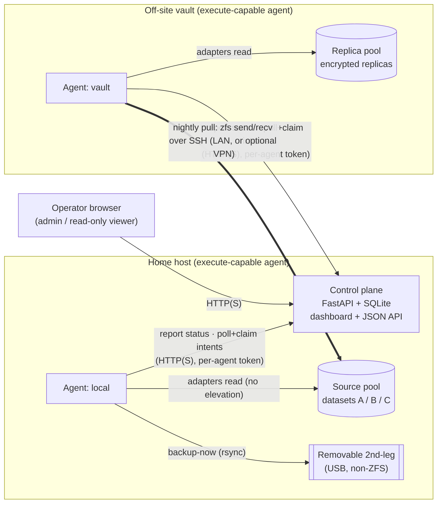
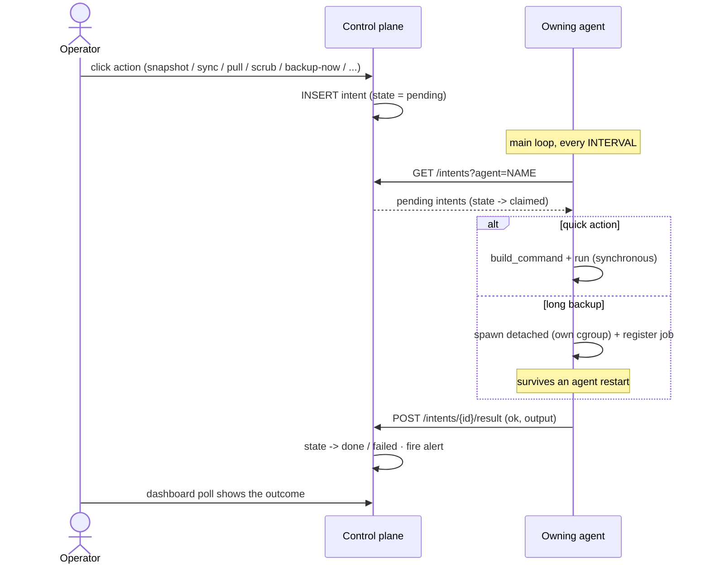
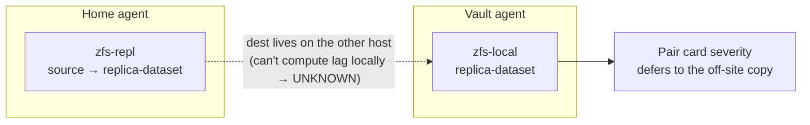

# Cairn architecture

How the pieces fit together: a small **control plane** that stores state and renders the
dashboard, and one or more **uniform agents** that report health and execute on-demand actions.
Agents never receive an inbound connection - they **poll** the control plane over HTTP(S) with a
per-agent token, so there is no phone-home to a cloud and nothing to expose at a remote site.

- **Control plane** - a single FastAPI process + SQLite, serving the dashboard and a small JSON
  API. It owns all state (targets, status history, intents, tokens, links) and fires alerts.
- **Agent** - the same `agent.py` + `collector.py` on every host, in one of two modes:
  *report-only* or *execute-capable*. It discovers backup targets, reports their health each
  cycle, and (if execute-capable) claims and runs queued actions.
- **Adapters** - the collector's per-technology probes: ZFS (pool + replication), borg, restic,
  rclone, snapper, backupninja, SMART, a removable 2nd-leg drive, kernel disk errors, ZFS events,
  backup schedules (systemd timers), AIDE integrity changes, and SSH reachability. Each returns a
  normalized status the control plane stores and scores. [targets.md](targets.md) is the full
  per-type reference.

*The dashboard is server-rendered by the control plane. Names here are anonymized;
[full-page capture](img/dashboard-full.png).*

## System topology

Both agents talk **only** to the control plane's HTTP(S) endpoint. The off-site pull is the one
agent-to-host data path, and it is initiated **outbound from the vault** (the vault SSHes to home
and runs `zfs send | recv`), so the vault needs no inbound ports. Home accepts SSH from the vault,
locked to a forced command.

## The intent / action queue

The dashboard never executes anything itself. An action becomes an **intent** row in SQLite; the
owning agent claims it on its next poll, runs it, and reports the result back. State lives entirely
in the control plane, so an agent can restart mid-flight without losing the work.

- **Allowlist** - the API accepts only these actions, each checked against the target's type:
  `snapshot`, `sync` (zfs-repl), `scrub` (zfs-local), `pull` (zfs-local replica), `backup-now`,
  `removable-scan`, `removable-verify`, `removable-relocate` (removable), `recover-points`,
  `recover-search`, `recover-deleted`, `restore`, `recover-versions`, `recover-dirtree`
  (dataset-backed targets), `recover-walk` (zfs-local), and `aide-accept` (aide). The agent builds
  the actual command from its own local target config, never from the request.
- **Routing** - each target is stored with the agent that reported it; intents for that target are
  handed to whichever caller polls with that agent name (see the limitation under Authentication).
  An action on a target owned by a report-only agent is refused.
- **Dry-run** - every action can run a native read-only probe (`-n` / list-only) instead of the
  mutating command, returning the *real* output of the probe.
- **Detached long jobs** - a real backup can run for hours. It is launched into its **own transient
  cgroup** (via `systemd-run --user`, falling back to `setsid`) so it neither blocks the agent's
  report/claim loop nor dies when the agent restarts. An on-disk job registry lets the agent *reap*
  the result (and report live progress: %, rate, ETA) on a later cycle.

## Authentication (hash-at-rest)

Only the **SHA-256 of each token** is stored, never the token itself. How a caller authenticates:

- **Agents** send their token in the `X-Backup-Token` header (`Authorization: Bearer` is also
  accepted).
- **Browsers** sign in at `/login`, either with a password account (`cairn-user.py`; mints a session
  token, default lifetime 7 days, `CAIRN_SESSION_TTL`) or by pasting a token. The token is kept in a
  cookie.
- **Public routes** need no token: `/login`, `/logout`, `/favicon.ico`, `/privacy`,
  `/api/v1/identify` and `/badge/*`. `/api/v1/backup/enroll` and `/api/v1/ci/status` are also outside
  the gate, but each checks its own secret (an enrollment secret, `CAIRN_CI_TOKEN`).

Every other route needs a token with the right role:

| Principal | Gets | Can |
| --- | --- | --- |
| **admin** | the bootstrap `CAIRN_ADMIN_TOKEN` (hashed at startup), an admin account, or a minted admin token | everything: views + queue actions + mint tokens |
| **viewer** | a viewer account or a read-only token | GET the dashboard and API; no actions, no token routes |
| **agent** | a static token from `CAIRN_AGENT_TOKENS`, a minted token, or a one-time enrollment secret it trades for a 24h access token | report status, poll/claim intents, post results - nothing else |

Per-agent tokens are individual rows, so any one token can be revoked without touching the others.
A dedicated, single-purpose **CI token** may push pipeline status to one route and nothing else, so
it is safe to hand to CI.

**Current limitation: agent tokens are not bound to an agent name.** The API trusts the `agent`
field an agent declares in its report, and `GET /api/v1/backup/intents?agent=NAME` hands out the
pending intents of whatever name is asked for. So any valid agent token can report as, or claim the
intents of, any other agent. Treat every agent token as trusted for the whole deployment.

*The same dashboard for a **viewer**: a READ-ONLY badge, and every action control (dry-run toggle,
Replicate now) is gone - the role is enforced server-side, not just hidden.*

## Adapters (what each agent monitors)

The collector normalizes every backup technology into the same status shape (severity + freshness
+ detail), so the dashboard scores them uniformly:

- **ZFS local** - pool health / capacity / scrub age / resilver + per-vdev errors; per-dataset
  snapshot freshness.
- **ZFS replication** - real replication lag = the age of the newest snapshot **common** to source
  and destination (not wall-clock), plus zero-knowledge awareness (flags a destination whose
  encryption key unexpectedly becomes available).
- **borg / restic / rclone / snapper / backupninja** - newest-archive freshness + counts, read
  without runtime elevation (group-readable repos; keys via env/keyfile references, never inline).
- **SMART** - per-disk health from `smartd`'s journal by default; an opt-in scoped `smartctl`
  wrapper adds the full attribute table. Removable/USB disks are excluded (covered by their own card).
- **Removable 2nd-leg** - see below.
- **Kernel errors** - disk I/O, link-reset and HBA errors from `journalctl -k` (or a plain-text
  kernel log), the only trace a self-healed transient leaves.
- **ZFS events** - a pool event timeline from zed's journal; recent bad events raise severity.
- **Schedules** - the systemd timers that drive backups (syncoid, sanoid by default): what each
  backs up, its schedule, and its last result.
- **AIDE** - file-integrity changes nobody has acknowledged yet; `aide-accept` acknowledges them.
- **Reachability** - an SSH probe of another host (typically the vault checking it can still reach
  home over the pull path), with retries.

See [targets.md](targets.md) for every type's config keys.

## Replication pairing

When a dataset is replicated to another host, cairn sees **two** status rows with the same name -
the sending side (a `zfs-repl` target on home) and the receiving side (a `zfs-local` target on the
vault). It auto-merges them into one **pair card** when the sender's destination is exactly the
receiver's source.

The sending host can't measure replication lag once the destination lives on a different agent, so
its half reports **UNKNOWN** by design. The pair's severity therefore **defers to the off-site
copy** - the meaningful end-to-end 3-2-1 signal (it goes stale if the source stops snapshotting
*or* the pull stalls). The hero counters are pair-aware, so a merged pair is counted once, at its
off-site half.

*A pair card: the two halves (source + off-site copy), the source dataset size for capacity
planning, and a tier badge - severity defers to the off-site half.*

## Removable 2nd-leg drive

An external drive is modeled as a `removable` target - the "2nd media" of 3-2-1. It is recognized
by a **stable id** (filesystem UUID / `by-id`), so its absence is a neutral *detached* state, never
an error. Datasets are **linked** to a subpath on the drive (namespaced `cairn/<host>/<slug>`), and
each link can independently:

- **census** its fit (dry-run rsync: what would be added, and whether it fits the free space),
- **verify** content (cached `user.b3sig` xattrs when the drive is tagged, else a full BLAKE3 hash),
- choose **additive** vs **mirror** (rsync `--delete`) per dataset,
- exclude top-level folders to fit a partial mirror.

A freshly-linked dataset (nothing on the drive yet) shows its size + fit + a first-sync prompt
rather than an empty diff, and flags a source that is unmounted or encrypted-and-locked.

*A removable card: drive capacity, a confirmed link (census/verify/mirror per dataset), and a
freshly-added dataset showing its size + fit + first-sync prompt instead of empty action buttons.*

## Off-site pull

The off-site replica is a **pull**, initiated by the vault, so nothing at the remote site is
exposed. `replication/vault-pull.sh` reads a flat config of replication **sets** (`SET name
source-dataset replica-dataset [raw]`) and runs `syncoid` over an SSH key restricted to a single
forced command on home. A nightly systemd `--user` timer pulls every set. Encrypted datasets are sent
**raw** (`zfs send -w`), so the vault stores ciphertext it cannot read.

The two "replicate" buttons do different things:

- **Replicate now** on the vault's `zfs-local` replica queues a `pull`, which runs
  `vault-pull.sh --only <target name>` on the vault. The vault target's name must equal the
  replication SET name. `./install.sh home --replication` names each SET after home's `zfs-repl`
  target, so name the vault's `zfs-local` target the same.
- **Replicate** on home's `zfs-repl` target queues a `sync`, which runs `syncoid` locally on home
  from the target's source to its dest.

Hosts do not need a mesh VPN. The installer defaults to home's LAN address for both the API URL and
the pull's SSH address. A VPN is optional, useful when the vault lives off-site.

## CI status without public pipelines

The public README badge is served by cairn itself, not by the (private) CI provider. CI `POST`s its
pass/fail to the control plane using the scoped CI token; the control plane renders an SVG badge at
a public route for the one allowed badge name. Internal pipelines stay private while their status is
still visible on the public README.

---

*Generic names (home / vault, source / replica, datasets A/B/C) stand in for a real deployment. See
the [README](../README.md) for install and operation, and `AGENT.md` for the agent's own runbook.*
